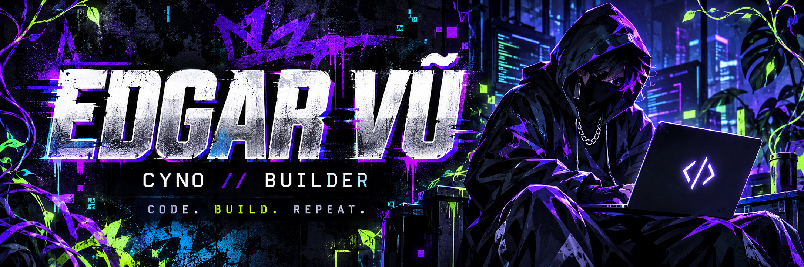
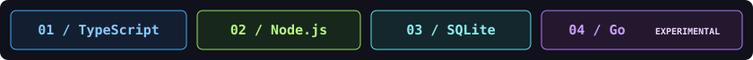

<div align="center">
  
  <br /><br />
  <a href="https://cyno.com.vn/"></a>&nbsp;
  <a href="https://github.com/vuthuanphat6-byte/lmti-atlas"></a>&nbsp;
  <a href="https://www.linkedin.com/in/thuan-phat-vu-035b101bb/"></a>
  <br /><br />
  <strong>BUILD WITH INTENT. SHIP WITH ATTITUDE.</strong>
</div>

<br />

### ⚡ `01 // THE BUILDER`

I'm **Edgar Vũ**. I build business software and local-first AI tools at **[Cyno](https://cyno.com.vn/)**.

My focus: giving AI coding agents useful project context, reusable knowledge, and reviewed lessons — with privacy boundaries built into the workflow.

```text
edgar@cyno:~$ cat mindset.txt
> make it useful
> keep the context local
> verify before you ship
```


### 🧠 `02 // CURRENT BUILD`

## [LMTI Atlas](https://github.com/vuthuanphat6-byte/lmti-atlas)

**Project memory. Better context. Less repeated exploration.**

A local-first project memory and safety layer for AI coding agents.

| Module | What it brings |
| :--- | :--- |
| 🗺️ **Project Atlas** | Compiles project knowledge into a reusable map. |
| 🎯 **Task Context** | Generates relevant context with privacy-aware preflight checks. |
| 🧩 **Reviewed Memory** | Preserves useful lessons through review and approval workflows. |

**`PUBLIC ALPHA`** · TypeScript CLI · SQLite-backed memory · Experimental Go core

Interfaces may change before a stable release. Memory supports source-code verification, tests, and human review.

**[Explore the code →](https://github.com/vuthuanphat6-byte/lmti-atlas)**


### 🛠️ `03 // THE TOOLBOX`



<br />

<div align="center">
  <sub><strong>LOCAL FIRST. ALWAYS CURIOUS.</strong></sub><br />
  <sub>Built with intent by Edgar Vũ / Cyno.</sub>
</div>
